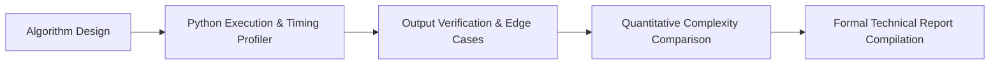

<p align="center">
  
</p>

<p align="center">
  
  
  
  
</p>

<a id="overview"></a>
## 📖 Executive Summary & Overview

Rigorous technical reporting documents the reasoning behind architectural trade-offs, space/time complexity analyses, and reproducibility guidelines. In software development, empirical reporting guarantees that algorithmic solutions can be audited, replicated, and integrated into larger systems with predictable performance.

The **Python Technical Analysis Portfolio** (`Python-assingnment-Report`) serves as a central archival repository for formal laboratory reports, runtime profiling comparisons, and algorithm benchmarking conducted across undergraduate computer science coursework.

<a id="toc"></a>
## 📑 Table of Contents

- [📖 Executive Summary & Overview](#overview)
- [🎯 Key Features & Capabilities](#features)
- [🏗️ System Architecture & Pipeline](#architecture)
- [🛠️ Tech Stack Breakdown](#tech-stack)
- [⚙️ Reproducible Quickstart & Setup](#setup)
- [📁 Project Directory Layout](#project-layout)
- [👨‍💻 Author & Contributions](#author)

<a id="features"></a>
## 🎯 Key Features & Capabilities

- **Complexity Profiling:** Empirical verification of Big-O asymptotic time and space complexities.
- **Structured Methodology Reports:** Formal documentation detailing input assumptions, pseudocode, execution traces, and error distributions.
- **Empirical Boundary Testing:** Documented edge-case evaluations testing null values, negative boundaries, and memory overflows.
- **Clean Academic Formatting:** Standardized report layouts meeting institutional academic guidelines.

<a id="architecture"></a>
## 🏗️ System Architecture & Pipeline



<a id="tech-stack"></a>
## 🛠️ Tech Stack Breakdown

| Category | Tool | Function |
| :--- | :--- | :--- |
| **Language** | Python 3.x | Core programming language for benchmarks |
| **Profiling Tools** | `time`, `cProfile` | Execution timing and bottleneck detection |
| **Documentation Format** | Markdown, LaTeX, Microsoft Word | High-fidelity technical reporting |

<a id="setup"></a>
## ⚙️ Reproducible Quickstart & Setup

```bash
# 1. Clone repository
git clone https://github.com/Amaraiah11/Python-assingnment-Report.git
cd Python-assingnment-Report

# 2. Inspect documentation and reports
```

<a id="project-layout"></a>
## 📁 Project Directory Layout

```text
Python-assingnment-Report/
└── README.md          # Technical analysis documentation and report archive
```

<a id="author"></a>
## 👨‍💻 Author & Contributions

This project is developed and maintained with high technical rigour by **Amaraiah C**, Software Engineer and Data Analytics Practitioner studying Bachelor of Computer Applications (BCA) at Alliance University.

- 🌐 **GitHub:** [@Amaraiah11](https://github.com/Amaraiah11)
- 💼 **LinkedIn:** [Connect on LinkedIn](https://www.linkedin.com/in/amaraiah-c/)
- 📧 **Institutional Contact:** `camaraiahBCA24@ced.alliance.edu.in`

### 🤝 Contribution Guidelines
Contributions, bug reports, and architectural discussions are welcome!
1. **Fork** the repository: `https://github.com/Amaraiah11/Python-assingnment-Report`
2. **Branch**: `git checkout -b feature/your-feature-name`
3. **Commit**: `git commit -m "feat: enhance feature logic"`
4. **Push**: `git push origin feature/your-feature-name`
5. **Open Pull Request** against the `main` branch.

---

<p align="center">
  <b>⭐ If this codebase or documentation assisted your engineering workflows, please star the repository! ⭐</b>
</p>

<p align="center">
  
</p>
