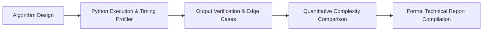

# 📊 Python Technical Analysis Portfolio — Computational Methodologies & Reports

<p align="center">
  
</p>

<p align="center">
  <b>Technical Computing Repository: Algorithmic Complexity Benchmarking, Time/Space Complexity Proofs, and Documented Case Studies.</b>
</p>

<p align="center">
  
  
  
  
</p>

<p align="center">
  
</p>

---

<a id="table-of-contents"></a>
## 📌 Table of Contents

- [📖 Executive Summary & Overview](#executive-summary--overview)
- [🎯 Key Features & Capabilities](#features)
- [🏗️ System Architecture & Pipeline](#system-architecture--pipeline)
- [🛠️ Tech Stack Breakdown](#tech-stack-breakdown)
- [⚙️ Reproducible Quickstart & Setup](#setup)
- [📁 Project Directory Layout](#project-layout)
- [🔮 Future Improvements & Roadmap](#future-improvements--roadmap)
- [🤝 Contributing Guidelines](#contributing-guidelines)
- [👨‍💻 Author & Contributions](#author--contributions)

---

<a id="executive-summary--overview"></a>
## 📖 Executive Summary & Overview

Rigorous technical reporting documents the reasoning behind architectural trade-offs, space/time complexity analyses, and reproducibility guidelines. In software development, empirical reporting guarantees that algorithmic solutions can be audited, replicated, and integrated into larger systems with predictable performance.

The **Python Technical Analysis Portfolio** (`Python-assingnment-Report`) serves as a central archival repository for formal laboratory reports, runtime profiling comparisons, and algorithm benchmarking conducted across undergraduate computer science coursework by **Amaraiah C**.

---

<a id="key-features--capabilities"></a>
## 🎯 Key Features & Capabilities

### ⏱️ 1. Complexity Profiling
- Empirical validation of Big-O asymptotic runtime behavior using Python's `time` and `cProfile` modules.

### 📐 2. Boundary Verification
- Edge-case testing covering null elements, empty collections, and extreme integer ranges.

---

<a id="system-architecture--pipeline"></a>
## 🏗️ System Architecture & Pipeline



---

<a id="tech-stack-breakdown"></a>
## 🛠️ Tech Stack Breakdown

| Category | Tool | Function |
| :--- | :--- | :--- |
| **Language** | Python 3.x | Core programming language for benchmarks |
| **Profiling Tools** | `time`, `cProfile` | Execution timing and bottleneck detection |
| **Documentation Format** | Markdown, LaTeX, Microsoft Word | High-fidelity technical reporting |

---

<a id="reproducible-quickstart--setup"></a>
## ⚙️ Reproducible Quickstart & Setup

```bash
# 1. Clone repository
git clone https://github.com/Amaraiah11/Python-assingnment-Report.git
cd Python-assingnment-Report

# 2. Inspect documentation and reports
```

---

<a id="project-directory-layout"></a>
## 📁 Project Directory Layout

```text
Python-assingnment-Report/
└── README.md          # Technical analysis documentation and report archive
```

---

<a id="future-improvements--roadmap"></a>
## 🔮 Future Improvements & Roadmap

- [ ] Incorporate automated GitHub Actions benchmarks for computational tasks.

---

<a id="author--contributions"></a>
## 👨‍💻 Author & Contributions

This project is developed and maintained with rigorous engineering standards by **Amaraiah C**, Software Developer and Applied Data Analytics Practitioner studying Bachelor of Computer Applications (BCA) at Alliance University, Bangalore.

- 🌐 **GitHub Profile:** [@Amaraiah11](https://github.com/Amaraiah11)
- 💼 **LinkedIn Profile:** [Connect on LinkedIn](https://www.linkedin.com/in/amaraiah-c/)
- 📧 **Institutional Email:** `camaraiahBCA24@ced.alliance.edu.in`

### 🤝 Contributing Guidelines
Contributions, bug reports, and architectural discussions are welcome!
1. **Fork** the repository: `https://github.com/Amaraiah11/Python-assingnment-Report`
2. **Create a Feature Branch:**
   ```bash
   git checkout -b feature/your-feature-name
   ```
3. **Commit Your Enhancements:**
   ```bash
   git commit -m "feat: enhance feature logic"
   ```
4. **Push to Your Branch:**
   ```bash
   git push origin feature/your-feature-name
   ```
5. **Open a Pull Request** against the `main` branch.

---

<p align="center">
  <b>⭐ If this codebase or documentation assisted your engineering workflows, please star the repository! ⭐</b>
</p>

<p align="center">
  
</p>
